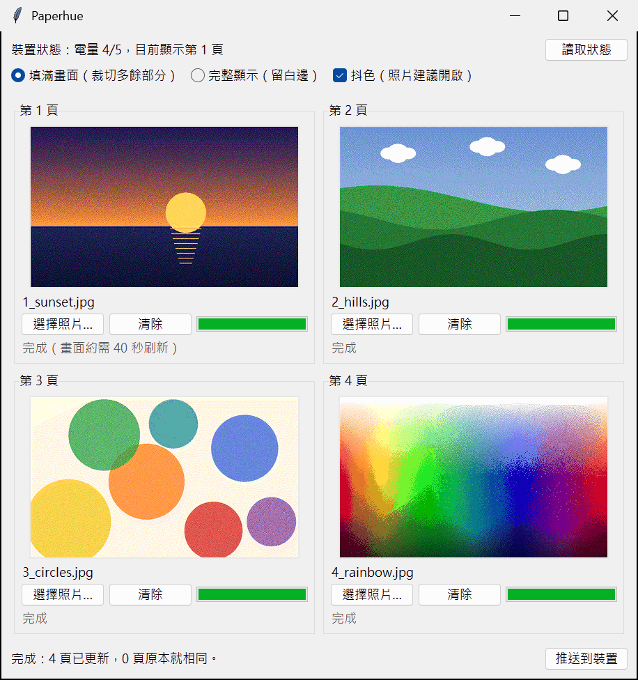

<p align="center"></p>

# Paperhue — free Windows app for the ULANI e-paper calendar (ULANI 永恆曆)

English | [繁體中文](README.zh-TW.md)

Paperhue is a free, open-source Windows app that puts your own photos,
your own calendar and to-do list, and short notes on a **ULANI 7-colour
e-paper device**. Pick up to four photos, see how each one will look in the
panel's seven colours, and send them to the device over Bluetooth. Any page
can instead show a month calendar, a week agenda or a to-do list drawn from
your own calendar's iCal address, updated by hand or every day, or a
message board with the notes you write. No account, no sign-in, no cloud
service in between.



## What it does

The device stores four pages, and its button cycles through them.
Paperhue fills each of those pages with either

- a **photo** you choose: Paperhue fits it to the 800 × 480 screen, converts
  it to the panel's seven colours and sends it over Bluetooth LE. The preview
  in Paperhue is drawn with only those seven colours, so you can judge the
  result before you send it; on the paper itself the colours look softer
  than on a monitor;
- a **calendar page**: 月曆 (month calendar), 一週行程 (week agenda) or
  待辦清單 (to-do list), drawn from your calendars (see
  [Calendar pages](#calendar-pages)); or
- a **message board page**: 留言板 (message board) or 大字留言 (one big
  message), showing the notes you write in Paperhue (see
  [Message board](#message-board)).

## Download

**[Download Paperhue.exe](https://github.com/markhhm/ulani-epaper/releases/latest/download/Paperhue.exe)**
(latest version)

- Windows 10 or 11, with Bluetooth LE (built into most laptops; a desktop PC
  may need a Bluetooth 4.0 or newer USB adapter).
- One file, nothing to install: save it anywhere and double-click it.
- Paperhue's screens are in Traditional Chinese. This guide gives the English
  meaning of every label you need.

## First-time setup

### 1. Let Windows open Paperhue

Your browser may first warn that Paperhue.exe is not commonly downloaded;
choose **Keep** (in Edge, open the **…** menu next to the download).

Paperhue.exe is not code-signed, so the first time you open it Windows may
say **"Windows protected your PC"**. Click **More info**, then **Run anyway**.

### 2. Pair the device with the PC (once)

The device only talks to computers it is paired with.

1. Hold the device's button for about 5 seconds, until the light blinks
   green (pairing mode).
2. On the PC, open **Settings → Bluetooth & devices → Add device →
   Bluetooth** (Windows 10: **Settings → Devices → Add Bluetooth or other
   device → Bluetooth**) and choose the device whose name starts with
   **ULANI Calendar**.
   If the device is not in the list on Windows 11, open **Settings →
   Bluetooth & devices → Devices**, set **Bluetooth devices discovery** to
   **Advanced**, put the device back in pairing mode and try again.
3. Open Paperhue and click **讀取狀態** (Read status). When the top line,
   裝置狀態 (device status), shows the battery level and the page on screen
   (for example 電量 4/5，目前顯示第 1 頁: battery 4 of 5, page 1 on screen;
   充電中 means charging), you are ready.

Another phone or computer that is also set up with the device can
overwrite your pages too; if you no longer use the device there, remove it
from that phone or computer.

## Putting photos on the device

1. For each page (**第 1 頁** to **第 4 頁**, page 1 to 4), click
   **選擇照片…** (Choose photo…) or the preview area, and pick a photo.
   JPG, PNG, BMP, GIF, WebP and TIFF work; convert HEIC photos to JPG first.
   Pages you leave empty stay as they are on the device. **清除** (Clear)
   removes the photo from that page in Paperhue; it does not erase anything
   on the device.
   Each page's **顯示** (Show) menu chooses what it holds: 照片 (photo), one
   of the calendar pages or one of the message board pages. Photos go on the
   pages set to 照片; by default that is page 4 (pages 1–3 are calendar
   pages), so first set the pages you want for photos to 照片.
2. Choose the options above the pages (they apply to all photo pages):
   - **填滿畫面（裁切多餘部分）** (Fill the screen, crop the rest): the photo
     fills the 5:3 screen. This is the default.
   - **完整顯示（留白邊）** (Show the whole photo, with white borders).
   - **顆粒感** (Grain): how the seven colours are mixed into finer shades.
     **標準** (Standard, the default) keeps the most detail; **柔和** (Soft),
     **更柔和** (Softer) and **最平滑** (Smoothest) give calmer, less grainy
     pictures with more visible bands of colour.

   After a few seconds the previews show each photo in the panel's seven
   colours, captioned 預覽為裝置實際顯示的 7 色效果 (preview of what the
   device will show; 產生預覽中… means the preview is still being made).
   **推送照片到裝置** becomes available once every preview is ready.
3. Click **推送照片到裝置** (Push photos to device). Each page shows its own progress:
   等待中 (waiting) · 準備傳送（1/4） (getting ready, 1 of 4) · 傳送中 37%
   (sending) · 已是這張照片，略過 (already on the device, skipped) · 完成
   (done; 畫面約需 40 秒刷新 means the screen needs about 40 seconds to
   redraw) · 未完成 (not finished). At the end the bottom line shows, for
   example, 完成：3 頁已更新，1 頁原本就相同 (Done: 3 pages updated, 1 was
   already the same).

Paperhue sends the page that is on the device's screen last, so the panel
refreshes only once, at the end. Sending usually takes 25–30 seconds per page
(up to about 50 seconds on a slow Bluetooth link), so four pages take about
2 minutes. A page that already holds the same photo is skipped. Keep Paperhue
open until the bottom line says **完成** (Done). The device then needs about
40 seconds more to redraw its screen. The other pages are stored on the
device; press its button to see them.

If you close Paperhue while it is sending, it asks 確定要關閉嗎？ (Close
anyway?). Closing stops the push; just push again later.

**Shortcut:** drag up to four photos onto the **Paperhue.exe** file icon
(not onto the open window). Paperhue opens with them on the photo pages; if
there are more photos than photo pages, it asks whether to turn other
pages into photo pages. Windows decides the order, so check each page before
you push.

## Calendar pages

Any page can show your own calendar, drawn like a phone widget:

| 月曆 (month) | 一週行程 (week agenda) | 待辦清單 (to-do list) |
|---|---|---|
|  |  |  |

- **月曆** (month): today's date and events beside a small month with
  coloured dots on the days that have events.
- **一週行程** (week agenda): what is next, the rest of today and the
  following six days.
- **待辦清單** (to-do list): your open to-dos, overdue ones in red.

The pages come from your calendars' **iCal (.ics) addresses**, for example
Google Calendar's "secret address in iCal format" or an Outlook published
calendar. Paperhue simply downloads those addresses, like subscribing to a
calendar: no Google or other API, no cloud project, no sign-in.

1. Click **行事曆來源…** (Calendar sources…) → **新增…** (Add…), give the
   source a name (it is shown on the pages, for example 個人, personal),
   paste its address, pick a colour and click **檢查並儲存** (Check and
   save). Paperhue downloads it once and tells you how many events and
   to-dos it found. You can add several sources, each in its own colour.
2. Set each page's **顯示** (Show) menu to 月曆, 一週行程 or 待辦清單.
3. Click **立即同步** (Sync now) to update the pages now, or **每日排程…**
   (Daily schedule…) to let Windows Task Scheduler update them at fixed
   times every day (06:00, 12:00 and 18:00 unless you change them). The PC
   must be on and signed in to Windows; a time missed while it was off or
   asleep is made up when it is back.

A secret address works like a password: anyone who has it can read that
whole calendar. Paste it only into Paperhue. Paperhue keeps it in the
Windows Credential Manager, never in a file, and shows only its host name
(for example calendar.google.com). It only reads your calendars, and nothing
it downloads is saved on the computer.

Pages whose content has not changed are skipped, so the panel does not
redraw for nothing. [docs/CALENDARS.md](docs/CALENDARS.md) shows where
Google Calendar, Apple iCloud, Outlook and others keep the address, which
to-do services work, and what to do when a source stops working (in
Chinese, with an English summary).

## Message board

A page can also hold short notes for whoever walks by:

| 留言板 (message board) | 大字留言 (one big message) |
|---|---|
|  |  |

- **留言板** (message board): the newest six notes as coloured sticky
  notes, each with the time it was written.
- **大字留言** (one big message): the newest note alone, as large as it
  fits.

1. Set a page's **顯示** (Show) menu to 留言板 or 大字留言. Until you do,
   the note window says 還沒有留言頁 (no message board page yet) and
   **張貼並顯示** stays greyed out.
2. Click **留言…** (Note…), write your note (up to 300 characters and 8
   lines), pick its colour (黃 yellow, 橘 orange, 綠 green, 藍 blue or 紅
   red) and click **張貼並顯示** (Post and show).

Paperhue sends only the message board pages and switches the device to the
board page (the 大字留言 page if you have both), so the note is on screen
once the panel has redrawn, about 40 seconds later. Posting needs no
internet. The same window lists the notes so far, newest first: select one
and click **刪除** (Delete), or click **全部清除** (Clear all); the board
pages are then updated without switching the page on screen.

Paperhue keeps your newest 50 notes on the computer. If sending fails, the
note is still saved: once the device is in range, open **留言…** and click
**重新送出** (Send again), or run `ulani note push`. **立即同步** (Sync now)
and the daily schedule redraw only the calendar pages, never the board pages.

## Troubleshooting

When something goes wrong, Paperhue shows a pop-up titled 推送失敗 (Push
failed), 同步失敗 (Sync failed), 留言推送失敗 (Note push failed) or
讀取狀態失敗 (Read status failed). The first line explains the problem in
Chinese; the technical details under it are in English (a rare
unexpected error shows only the English text). Look up the first words here.
A photo that Paperhue cannot open shows 無法讀取 … under its page instead.

| Message | What to do |
|---|---|
| 裝置尚未與這台電腦配對 (not paired with this PC) | Pair the device as described above. |
| 找不到裝置或連不上 (device not found or cannot connect) | Bring the device near the PC, check that the PC's Bluetooth is on and that the device is paired with this PC, and make sure no other phone or computer is connected to it right now. Then push again. |
| 裝置沒有回應 (device not responding) | It is probably still refreshing its screen (about 40 seconds). Wait a minute and push again. |
| 裝置回報收到的資料有誤 (device received damaged data) | Push again. |
| 藍牙連線中斷 (Bluetooth connection lost) | Move the PC closer to the device and push again. |
| 無法讀取 … (cannot read a photo) | The file is damaged, too large, or in a format Paperhue cannot open (convert HEIC to JPG). |
| 還沒有行事曆來源 (no calendar sources yet) | Add one with **行事曆來源…** (Calendar sources…). |
| 無法讀取行事曆來源 (cannot read a calendar source) | Check the internet connection. If the source's address was reset, paste the new one with **行事曆來源…** → **編輯…** (Edit…). The details name the source and the HTTP error. |

More tips:

- The device sends a Bluetooth signal only now and then to save battery.
  Paperhue keeps trying for about two minutes before it gives up, so
  連線中… (Connecting…) or 連線並推送中… (Connecting and pushing…) can stay
  on screen for a while. If it gives up (a pop-up appears; after 讀取狀態 the
  top line says 裝置狀態：連不上, cannot connect), try again.
- If a push stops half-way, push again: pages that already hold their photo
  are skipped.
- If the device shows a different page after a push, press its button to
  go to the page you want.
- If the PC cannot connect any more after the device was paired with
  another phone or computer, remove the device in Windows' Bluetooth settings
  and pair it again.

Still stuck? Open an issue on
[GitHub](https://github.com/markhhm/ulani-epaper/issues) and include the
message Paperhue showed.

## Privacy

Paperhue needs no account and uses no cloud service. Your photos and notes
never leave your computer, except over the Bluetooth link to your own
device.

The only internet access is downloading the calendar addresses you add.
Each address works like a password, so Paperhue keeps it in the Windows
Credential Manager, not in a file, and shows only its host name (for
example calendar.google.com). Events and to-dos are downloaded, drawn and
sent to the device in memory; nothing from your calendars is saved on the
computer. The sync log keeps only the time, the outcome and how many events,
to-dos and notes there were. Your notes themselves are kept on the computer
(in `%APPDATA%\ulani-epaper\notes.json`) so that the board can be redrawn.

## For developers

Paperhue is built on a small Python library, `ulani-epaper`, which you can
use in your own scripts (Python 3.10–3.14):

```
pip install "ulani-epaper @ git+https://github.com/markhhm/ulani-epaper#subdirectory=python"
```

```python
import asyncio
from ulani_epaper.push import push_images

# photo n goes to page n; None leaves that page alone
asyncio.run(push_images(["a.jpg", "b.jpg", None, "d.jpg"]))
```

It also installs the `ulani` command-line tool (`ulani push`, `ulani send`,
`ulani text`, `ulani info`, …); `ulani note` posts to the message board.
The calendar pages (`ulani feeds`, `ulani sync`, `ulani schedule`) need the
`calendar` extra:

```
pip install "ulani-epaper[calendar] @ git+https://github.com/markhhm/ulani-epaper#subdirectory=python"
```

[python/README.md](python/README.md) covers the API, the command-line tool,
tests and building Paperhue.exe; [shared/PROTOCOL.md](shared/PROTOCOL.md)
describes the Bluetooth protocol.

| Folder | Contents |
|---|---|
| [`python/`](python/) | the `ulani-epaper` library, the `ulani` command-line tool and the Paperhue Windows app |
| [`apple/`](apple/) | a Swift version of the library (in development, not released) |
| [`shared/`](shared/) | protocol notes, the calendar page specs, test vectors and reference renders shared by both |
| [`docs/`](docs/) | the calendar guide and images for the READMEs |

## License

MIT, see [LICENSE](LICENSE). The calendar pages are drawn with a subset of
Noto Sans CJK TC, under the SIL Open Font License 1.1
([python/src/ulani_epaper/fonts/OFL.txt](python/src/ulani_epaper/fonts/OFL.txt)).

ULANI is a trademark of its respective owner. Paperhue is an independent
open-source project and is not affiliated with, endorsed by or sponsored by
ULANI.
