<p align="center">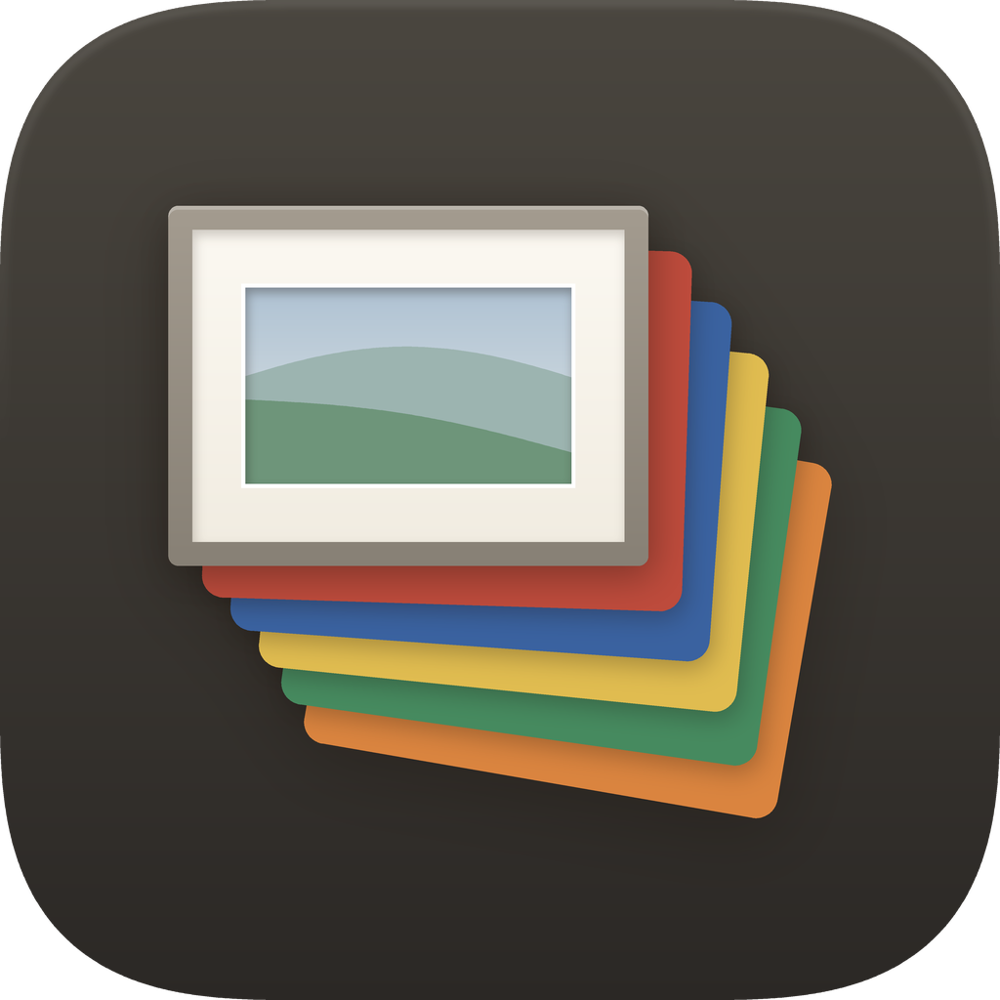</p>

# Paperhue — make your ULANI 永恆曆 truly last forever

English | [繁體中文](README.zh-TW.md)

A perpetual calendar should keep working for as long as the device does.
Paperhue is open source, needs no account and has no server of its own:
your computer or phone talks to the device directly over Bluetooth, and
because the code is public, anyone can keep building and running it. It
runs on Windows, Mac, iPhone (in the Bluefy browser) and Android.

Paperhue puts your own photos, your own calendar and to-do list, short
notes and cards you design on a **ULANI 7-colour e-paper device**. Pick up
to four photos, choose which part of each one to show, see how it will look
in the panel's seven colours, and send them to the device over Bluetooth.
Any page can instead show a month calendar, a week agenda or a to-do list
drawn from your own calendars, updated by hand or every day, a notes board
with the notes you write, or a card: a status, a meme or a
quote on a photo or a colour. No account, no sign-in, no cloud service in
between. The app speaks English and Traditional Chinese.

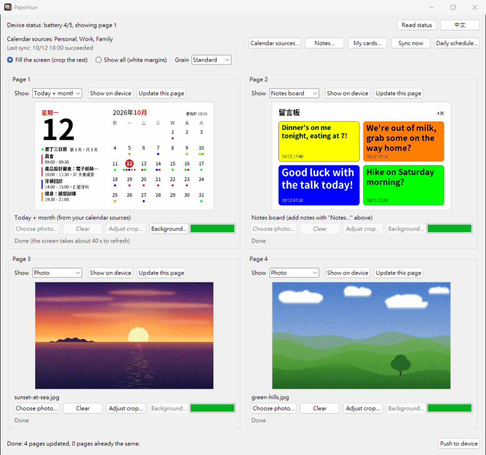

## What it does

The device stores four pages, and its button cycles through them.
Paperhue fills each of those pages with

- a **photo** you choose: Paperhue fits it to the 800 × 480 screen,
  converts it to the panel's seven colours and sends it over Bluetooth LE.
  You can move and zoom the part of the photo that is shown. The preview in
  Paperhue is drawn with only those seven colours, so you can judge the
  result before you send it; on the paper itself the colours look softer
  than on a monitor;
- a **calendar page**: Today + month, Today + week, To-do, Day or Month,
  drawn from your calendars (see [Calendar pages](#calendar-pages));
- a **notes page** (Windows and Mac): Notes board or Big message, showing
  the notes you write in Paperhue (see [Message board](#message-board)); or
- a **card**: a picture you make in Paperhue from a photo (cropped as you
  like) or one of the seven colours, with a few text boxes on it, for a
  status such as "In a meeting, back at 15:00", a meme with a short line or
  a quote (see [Cards](#cards)).

## Download

**[Download Paperhue.exe](https://github.com/markhhm/ulani-epaper/releases/latest/download/Paperhue.exe)**
(latest version)

- Windows 10 or 11, with Bluetooth LE (built into most laptops; a desktop PC
  may need a Bluetooth 4.0 or newer USB adapter).
- One file, nothing to install: save it anywhere and double-click it.

**Mac:** [Download Paperhue-macOS.zip](https://github.com/markhhm/ulani-epaper/releases/latest/download/Paperhue-macOS.zip)
(macOS 14 or newer); see [Mac](#mac).

**iPhone:** nothing to download. Open Paperhue in the Bluefy browser; see
[iPhone](#iphone).

**Android:** [Download Paperhue-Android.apk](https://github.com/markhhm/ulani-epaper/releases/latest/download/Paperhue-Android.apk)
(Android 7 or newer); see [Android](#android).

## English or Chinese

Paperhue starts in the language of your computer or phone: Traditional
Chinese if it is set to Chinese, English otherwise. The button in the top
bar shows the other language (**中文** while Paperhue is in English,
**English** while it is in Chinese); one click switches every text,
including open windows, without losing your photos or a push in progress.
Paperhue remembers your choice. On a Mac, the menu bar follows the next time
you open Paperhue. This guide uses the English labels; the Chinese ones are in
[README.zh-TW.md](README.zh-TW.md). The pages drawn on the device (calendar
and notes pages) are in Chinese for now.

## First-time setup

### 1. Let Windows open Paperhue

Your browser may first warn that Paperhue.exe is not commonly downloaded;
choose **Keep** (in Edge, open the **…** menu next to the download).

Paperhue.exe is not code-signed, so the first time you open it Windows may
say **"Windows protected your PC"**. Click **More info**, then **Run anyway**.

### 2. Pair the device with the PC

The device only talks to computers it is paired with.

1. Hold the device's button for about 5 seconds, until the light blinks
   green (pairing mode).
2. On the PC, open **Settings → Bluetooth & devices → Add device →
   Bluetooth** (Windows 10: **Settings → Devices → Add Bluetooth or other
   device → Bluetooth**) and choose the device whose name starts with
   **ULANI Calendar**.
   If the device is not in the list on Windows 11, open **Settings →
   Bluetooth & devices → Devices**, set **Bluetooth devices discovery** to
   **Advanced**, put the device back in pairing mode and try again.
3. Open Paperhue and click **Read status**. When the top line,
   **Device status**, shows the battery level and the page on screen (for
   example "Device status: battery 4/5, showing page 1"; "charging" means
   it is charging), you are ready.

**One phone or computer at a time.** The device remembers only the phone
or computer it was paired with last: pairing it with another one makes it
forget the previous one. To switch back, forget (remove) the device in that
phone's or computer's Bluetooth settings, put the device in pairing mode
(hold its button about 5 seconds until the light blinks green) and pair it
again.

## Putting photos on the device

1. For each page (**Page 1** to **Page 4**), click **Choose photo…** or the
   preview area, and pick a photo. JPG, PNG, BMP, GIF, WebP and TIFF work;
   convert HEIC photos to JPG first. Pages you leave empty stay as they are
   on the device. **Clear** removes the photo from that page in Paperhue; it
   does not erase anything on the device.
   Each page's **Show** menu chooses what it holds: Photo, one of the
   calendar pages, one of the notes pages or Card. Photos go on the pages
   set to Photo; by default that is page 4 (pages 1–3 are calendar pages),
   so first set the pages you want for photos to Photo.
2. Choose the options above the pages (they apply to all photo pages):
   - **Fill the screen (crop the rest)**: the photo fills the 5:3 screen.
     This is the default. **Adjust crop…** (below) chooses which part.
   - **Show all (white margins)**: the whole photo, with white borders.
   - **Grain**: how the seven colours are mixed into finer shades.
     **Standard** (the default) keeps the most detail; **Soft**, **Softer**
     and **Smoothest** give calmer, less grainy pictures with more visible
     bands of colour.

   After a few seconds the previews show each photo in the panel's seven
   colours, captioned "Preview in the device's 7 colours" ("Making
   preview…" means the preview is still being made). **Push to device**
   becomes available once every preview is ready.
3. Click **Push to device**. It sends, in one go, every page that has
   something on it: the photo pages with a photo, the calendar pages (your
   calendars are read first), the notes pages and the card pages with a card
   chosen in **My cards…**. Each page shows its own progress: Waiting ·
   Getting ready (1/4) · Sending 37% · Nothing changed, skipped · Done (the
   screen takes about 40 s to refresh) · Not finished. At the end the bottom
   line shows, for example, "Done: 3 pages updated, 1 page already the same."

Choosing photos, crops, page kinds and backgrounds, writing notes and
choosing cards only change the previews in Paperhue: nothing reaches the
device until you push, so make all your changes first. **Update this page**
at the top of a page sends that page alone. (In **My cards…**, **Put on
page N** under a card chooses it for a page set to Card; with several card
pages, **Put on…** asks which.)

Paperhue sends the page that is on the device's screen last, so the panel
refreshes only once, at the end, and the device keeps showing the page it
was on. Sending usually takes 25–30 seconds per page (up to about 50 seconds
on a slow Bluetooth link), so four pages take about 2 minutes. A page that
already holds the same image is skipped. If your calendars can't be read
(for example while offline), the other pages are still sent and the bottom
line says the calendar pages were not updated. Keep Paperhue open until the
bottom line says **Done**. The device then needs about 40 seconds more to
redraw its screen. The other pages are stored on the device; press its
button to see them.

If you close Paperhue while it is sending, it asks "Still sending to the
device. Quitting now interrupts the transfer. Quit anyway?". Closing stops
the push; just push again later.

**Shortcut:** drag up to four photos onto the **Paperhue.exe** file icon
(not onto the open window). Paperhue opens with them on the photo pages; if
there are more photos than photo pages, it asks whether to turn other
pages into photo pages. Windows decides the order, so check each page before
you push.

### Choosing which part of a photo to show

With **Fill the screen (crop the rest)**, click **Adjust crop…** under a
page's photo (or double-click the preview) to choose what fills the screen.
The window shows the whole photo with the part outside the crop dimmed:

- drag inside the frame to move it;
- drag a corner, turn the mouse wheel or use the **Zoom** slider to make it
  smaller or larger (it always keeps the screen's 5:3 shape);
- the arrow keys nudge it (hold Shift to go faster);
- **Reset** goes back to the centred crop, **Cancel** leaves the page as it
  was, **OK** keeps your choice and redraws the preview.

Paperhue keeps the crop for each page until you choose another photo for it
or close the app. With **Show all (white margins)** the crop is ignored but
not forgotten.

### Big photos

Photos over **50 megapixels** (for example wider than about 8,000 × 6,250
pixels) are refused: the page says "This photo is over the 50-megapixel
limit. Shrink it, then choose it again." Every other photo is reduced to fit
4K (3840 × 2160 pixels; 2160 × 3840 for a portrait photo) when Paperhue
opens it. That is far more than the 800 × 480 screen can show, so the result
looks the same, and previews and the crop window stay quick. A photo that
already fits is left as it is, and Paperhue never enlarges one.

### Showing a page

**Show on device** at the top of each page switches the device to that
page, like pressing the device's button. Nothing is sent, and the screen
takes about 40 seconds to redraw.

## Calendar pages

Any page can show your own calendar, drawn like a phone widget:

| Today + month (本日＋月曆) | Today + week (本日行程＋一週行程) | To-do (待辦清單) |
|---|---|---|
| 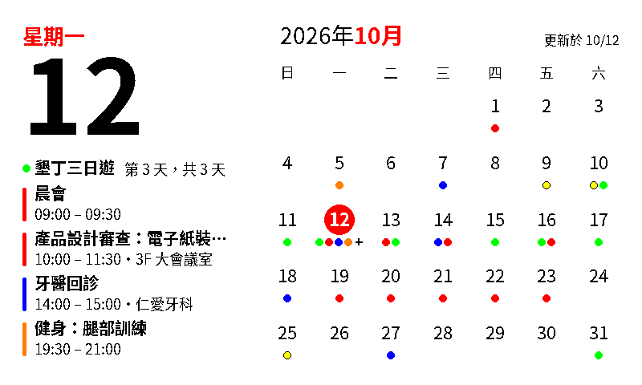 | 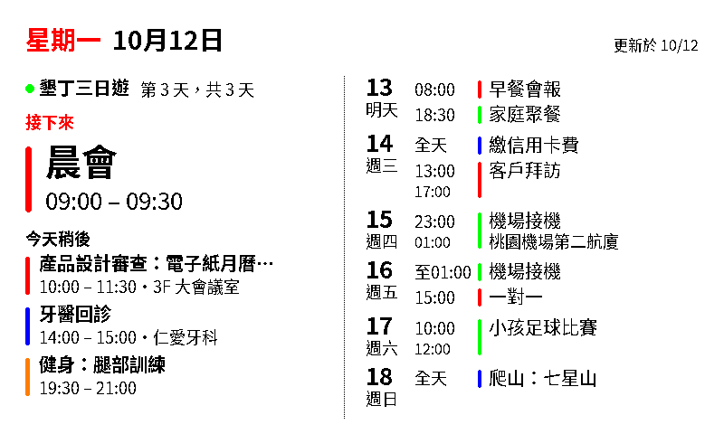 | 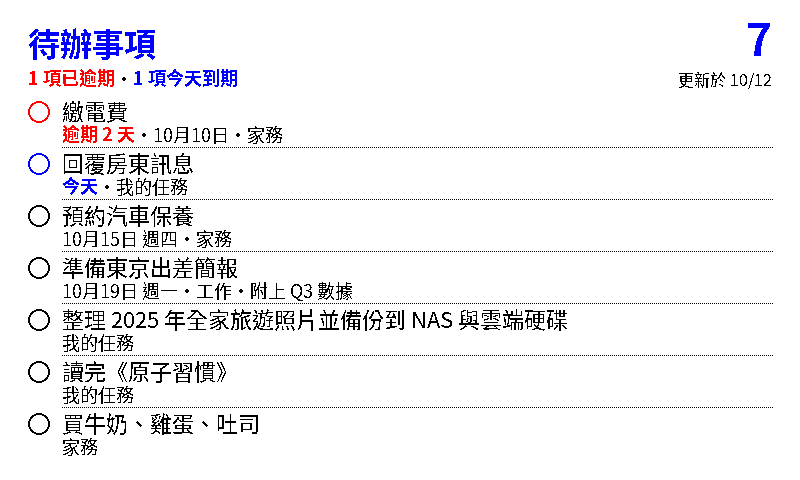 |
| **Day (日)** | **Month (月曆)** | |
| 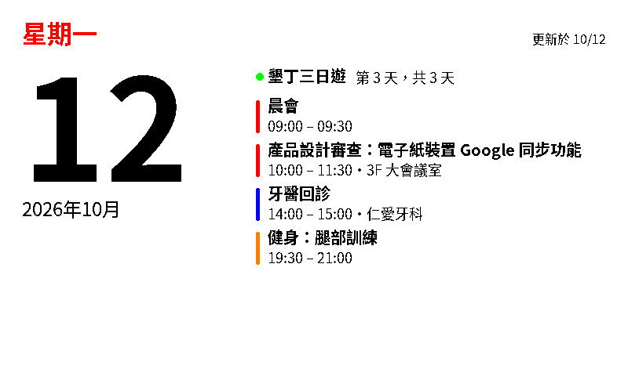 | 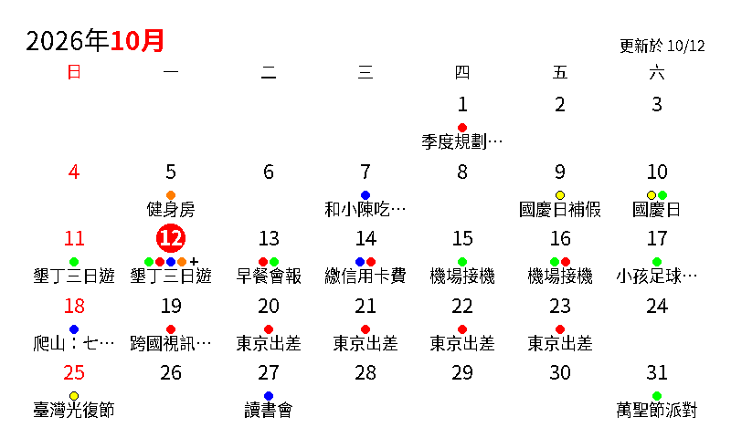 | |

- **Today + month**: today's date and events beside a small month with
  coloured dots on the days that have events.
- **Today + week**: what is next, the rest of today and the following six
  days.
- **To-do**: your open to-dos, overdue ones in red.
- **Day** (日): a big date, the weekday and today's events.
- **Month** (月曆): the whole month as a grid, Sundays in red, with event
  dots and short titles.

With no calendar source at all, the calendar pages show the public Taiwan
holidays calendar.

The pages come from your calendars' **iCal (.ics) addresses**, for example
Google Calendar's "secret address in iCal format" or an Outlook published
calendar. Paperhue simply downloads those addresses, like subscribing to a
calendar: no Google or other API, no cloud project, no sign-in.

1. Click **Calendar sources…** → **Add…**, give the source a name (it is
   shown on the pages, for example "Personal"), paste its address, pick a
   colour and click **Check and save**. Paperhue downloads it once and tells
   you how many upcoming events and to-dos it found. You can add several
   sources, each in its own colour.
2. Set each page's **Show** menu to one of the calendar pages above.
3. Click **Sync now** to update the pages now, or **Daily schedule…** to let
   Windows Task Scheduler update them at times you choose every day (for
   example one in the morning and one in the afternoon). The schedule is
   off ("Now: off") until you enter at least one time and click **Turn on /
   update**; **Turn off** removes it. The PC must be on and signed in to
   Windows; a time missed while it was off or asleep is made up when it is
   back. The line under the calendar sources shows how the last sync went,
   for example "Last sync: 10/12 18:00 succeeded".

A secret address works like a password: anyone who has it can read that
whole calendar. Paste it only into Paperhue. Paperhue keeps it in the
Windows Credential Manager, never in a file, and shows only its host name
(for example calendar.google.com). It only reads your calendars, and nothing
it downloads is saved on the computer.

Pages whose content has not changed are skipped, so the panel does not
redraw for nothing. [docs/CALENDARS.md](docs/CALENDARS.md) shows where
Google Calendar, Apple iCloud, Outlook and others keep the address, which
to-do services work, and what to do when a source stops working (in
Chinese, with an English summary).

## Message board

A page can also hold short notes for whoever walks by:

| Notes board (留言板) | Big message (大字留言) |
|---|---|
| 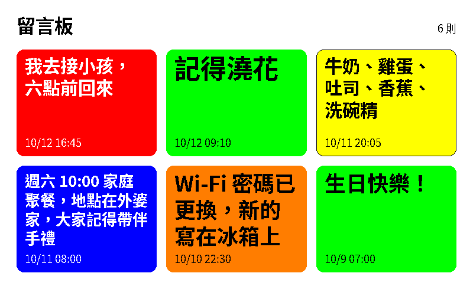 | 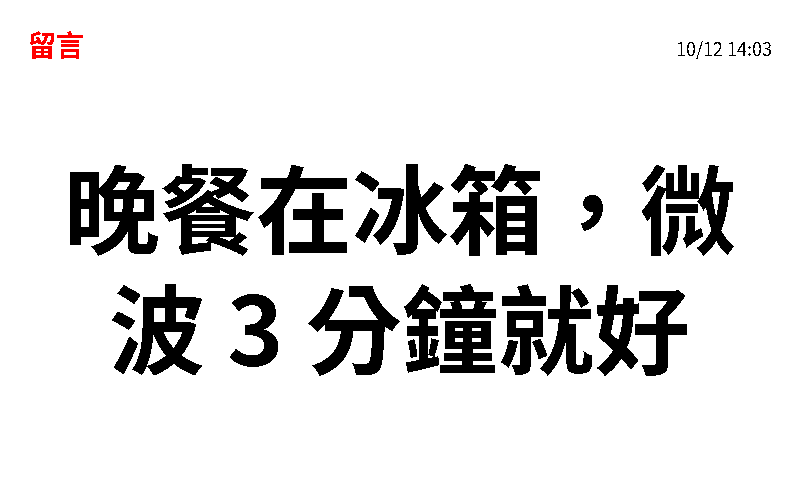 |

- **Notes board**: the newest six notes as coloured sticky notes, each with
  the time it was written.
- **Big message**: the newest note alone, as large as it fits.

1. Set a page's **Show** menu to Notes board or Big message. Until you do,
   the notes window says "No page shows notes yet" ("No notes page yet" on
   a Mac), and on Windows **Add note** stays greyed out.
2. Click **Notes…**, write your note (up to 300 characters and 8 lines),
   pick its colour (Yellow, Orange, Green, Blue or Red) and click **Add
   note**. The notes pages' previews show it at once.
3. Click **Push to device**, or **Update this page** on a notes page, to
   send the notes to the device. Click **Show on device** on that page to
   switch the device to it.

Adding a note needs no internet. The same window lists the notes so far,
newest first: select one and click **Delete**, or click **Clear all**; like
a new note, the change reaches the device with your next push.

Paperhue keeps your newest 50 notes on the computer. If sending fails, the
notes are still saved: once the device is in range, push again, or run
`ulani note push`. **Sync now** and the daily schedule redraw only the
calendar pages, never the notes pages.

## Cards

A card is a picture you make in Paperhue: a photo or one of the seven
colours, with up to eight text boxes on it. Use one for a status, a meme or a
quote:

| Status on a colour | Meme on a photo |
|---|---|
| 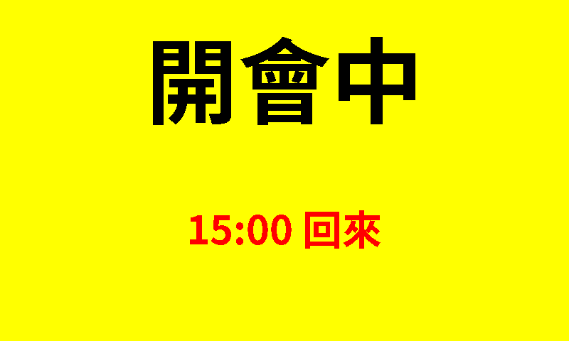 |  |
| **Quote with its source** | **Several lines in one text box** |
| 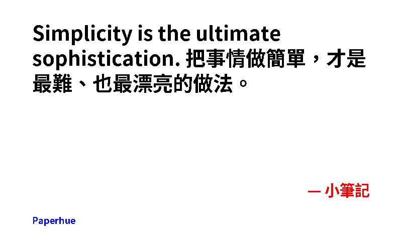 | 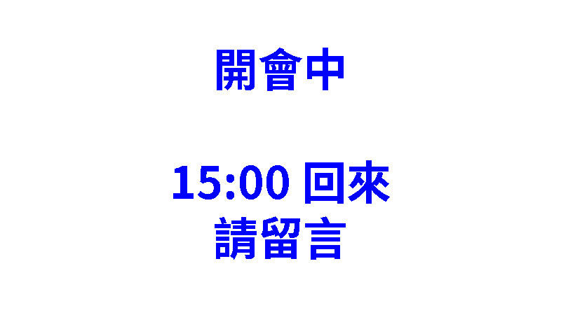 |

1. Click **My cards…**, then **New card…**. Under **Background**, pick a
   colour, or click **Photo…** and choose its part with **Adjust crop…**.
   **Add text box** adds a text box (up to 80 characters each): drag it to move it,
   drag a corner to resize it, and set its **Size** (or turn the mouse
   wheel), **Text colour**, **Outline** and **Align**. The preview shows the
   device's seven colours. Click **Save**.
2. Set a page's **Show** menu to Card, then click **Put on page N** under
   the card in **My cards…** (with several card pages, **Put on…** asks
   which; with none, Paperhue offers to make one).
3. Click **Push to device**, or **Update this page** on the card page.
   Nothing is sent until you push.

With several card pages, put a different card on each and push once;
**Show on device** then switches between them without sending anything.
**Sync now** and the daily schedule never change a card page.

Tick a card in **My cards…**, then click **Edit…**, **Duplicate**,
**Delete** or **Export…**. **Export…** saves the card and its photo as one
`.paperhue-card` file, and **Import…** adds one: that is how a card moves
between Paperhue on Windows, Mac, iPhone and Android.

On a phone, cards are in the **My cards** tab: **New card** makes one, a tap
on a card sends it to a card page and switches the device to it, and
**Preload to the device** fills several card pages at once without switching
the screen. **Save as a card file** (in the editor) and **Import a card**
move cards between apps.

## iPhone

On an iPhone, Paperhue is a web page that you open in the free **Bluefy**
browser (Safari cannot use Bluetooth). It makes cards (a short message, a
status such as "Back at 3 pm", a quote or a meme), puts photos on the
device, and keeps the calendar pages up to date from the Calendar and
Reminders that are already on your iPhone, so there is no address to paste.
The phone must be near the device, because the only link is Bluetooth.
**Pages** lists the device's four pages: choose what each one shows, give a
photo page its photo and send it, and switch the device to a page with
**Show on device**; cards are sent from **My cards**.

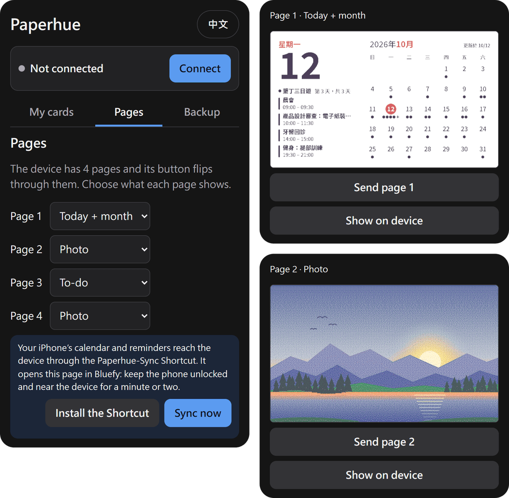

### 1. Set up Bluefy

1. Install **Bluefy** from the App Store.
2. In Bluefy, open **https://markhhm.github.io/ulani-epaper/** and bookmark
   it.
3. Hold the device's button for about 5 seconds, until the light blinks
   green (pairing mode). In the page tap **Connect**, choose the device
   whose name starts with **ULANI Calendar** and accept the pairing
   request. When the top of the page shows the battery level, you are ready.
   The device remembers
   [one phone or computer at a time](#2-pair-the-device-with-the-pc): if it
   has been paired with another one since, forget it in the iPhone's
   **Settings → Bluetooth**, then do this step again.

### 2. Calendar sync with a Shortcut

The **Paperhue-Sync** Shortcut reads the next 45 days of your iPhone
calendars and your open reminders, then opens Paperhue in Bluefy. The page
finds the paired device by itself (no tap), draws the pages that are set to
a calendar page, sends only the ones that changed and tells you how it went.
Cards, photos and notes pages are left alone.

1. In **Safari**, open
   [Paperhue-Sync.shortcut](https://markhhm.github.io/ulani-epaper/shortcuts/Paperhue-Sync.shortcut)
   and tap **Add Shortcut**. If it only downloads, open it from **Files →
   Downloads**. Keep its name, **Paperhue-Sync**: the **Sync now** button
   in Paperhue looks for that name. If it has another name, touch and hold
   it in the Shortcuts app and choose **Rename**.
2. Run it once by hand. When it asks for access to your Calendars and
   Reminders, and to open Bluefy, choose **Always Allow**, so that later runs
   do not ask again.
3. From then on, open Paperhue in Bluefy, go to **Pages** and tap **Sync
   now** whenever you want the calendar pages updated. (**Install the
   Shortcut** on the same page is the link from step 1.)

### 3. Update by itself at set times (optional)

Updates are manual until you set a schedule. In the **Shortcuts** app:

1. Open the **Automation** tab, tap **+** and choose **Time of Day**.
2. Pick a time when the phone is usually near the device (for example one in
   the morning and one in the afternoon; make one automation for each time)
   and **Repeat: Daily**, then tap **Next**.
3. Add the action **Run Shortcut**, choose **Paperhue-Sync**, tap **Next**.
4. Choose how it runs:
   - **Run Immediately**: it starts by itself at that time.
   - **Run After Confirmation** (**Ask Before Running** in some iOS versions):
     the phone shows a notification at that time, and you tap it and
     choose **Run**.

   This is the wording of iOS 17 and 18. Newer iOS versions may word it a
   little differently; look for the choice that starts by itself and the one
   that asks first.
5. Tap **Done**.

### Good to know

- **The phone must be unlocked.** The Shortcut opens Bluefy, and the page
  needs the screen on to talk to the device. If the phone is locked at that
  time the sync may not run; tap **Sync now** later.
- **Stay near the device.** Bluefy is in front for about 1 to 3 minutes and
  keeps the screen on while it works. If the page does not find the device
  within about a minute it gives up and says so; nothing is changed. Try
  again with **Sync now**.
- If you also use Paperhue on a computer, only the one paired last can
  reach the device: set a schedule only there, and use the same page plan
  (which page shows what) in all of them. The phone has no notes pages: set
  a page that shows notes on the computer to **Photo** on the phone and give
  it no photo, and the phone leaves it alone.
- **Back up your cards.** Cards, photos and settings are kept only in
  Bluefy's website storage on this iPhone, never on a server. iOS may clear a
  website's storage after you have not used the browser for a while, or when
  you clear Bluefy's data. Open **Backup** and tap **Export a backup** now
  and then, and keep the file (in **Files** or iCloud Drive); **Import a
  backup** puts everything back.
- Your calendar and reminders are not saved anywhere: the Shortcut keeps
  nothing, and the page holds them in memory only while it is open.

## Android

On Android, Paperhue is an app that works like the iPhone page (the
screenshot above): cards in **My cards**, and in **Pages** what each page
shows, with the photo of each photo page. It is not on Google Play: you
install it from this page.

1. **Download and install.** On the phone, download
   [Paperhue-Android.apk](https://github.com/markhhm/ulani-epaper/releases/latest/download/Paperhue-Android.apk)
   and open it. Android asks whether your browser (or Files app) may install
   apps: allow it, go back and tap **Install**. A newer version installs over
   it the same way and keeps your cards and settings.
2. **Connect.** Hold the device's button for about 5 seconds until the light
   blinks green (pairing mode). In Paperhue tap **Connect**, allow **Nearby
   devices**, choose the device and accept the pairing request. The device
   remembers [one phone or computer at a time](#2-pair-the-device-with-the-pc):
   if it has been paired with another one since, forget it in the phone's
   Bluetooth settings, then connect again this way.
3. **Calendar permission.** The calendar pages show the calendars that are
   on the phone (every account in its Calendar app). The first time you open
   **Pages**, Android asks whether Paperhue may access your calendar: choose
   **Allow**. If you said no, tap **Use this phone's calendars** there, or go
   to **Settings → Apps → Paperhue → Permissions → Calendar**. Under **iCal
   addresses** you can add calendars that are not on the phone, and to-do
   lists (optional). With no calendar at all, the pages show Taiwan's public
   holidays.
4. **Scheduled sync (optional).** It is off until you add a time: in
   **Pages → Scheduled sync**, add one or more times, for example one in the
   morning and one in the afternoon. At each time Paperhue updates the
   calendar pages without opening the app (a notification shows while it
   works), when Bluetooth is on and the phone is near the device. If the
   device is not found, it tries again every 15 minutes for 2 hours, then
   skips that time. The last runs are listed under the times. Cards, photos
   and notes pages are never touched.
5. **Battery setting.** When you add the first time, Android asks whether
   Paperhue may always run in the background: choose **Allow**, or the runs
   may be late or skipped. To change it later: **Settings → Apps → Paperhue →
   Battery → Unrestricted** (the words differ a little between phone makers).

The phone's calendar is read only while the pages are drawn and is not
saved; iCal addresses stay in the app on this phone. If you also use
Paperhue on a computer or an iPhone, only the one paired last can reach the
device: set a schedule only there, and use the same page plan in all of them
(a notes page of the computer is a **Photo** page with no photo on the
phone).

## Mac

On a Mac, Paperhue does what it does on Windows: it puts photos, calendar
pages, notes and cards on the device. Each
page's **Show** menu picks **Photo**, **Today + month**, **Today + week**,
**To-do**, **Day**, **Month**, **Notes board**, **Big message** or **Card**
(see [Calendar pages](#calendar-pages), [Message board](#message-board) and
[Cards](#cards)).

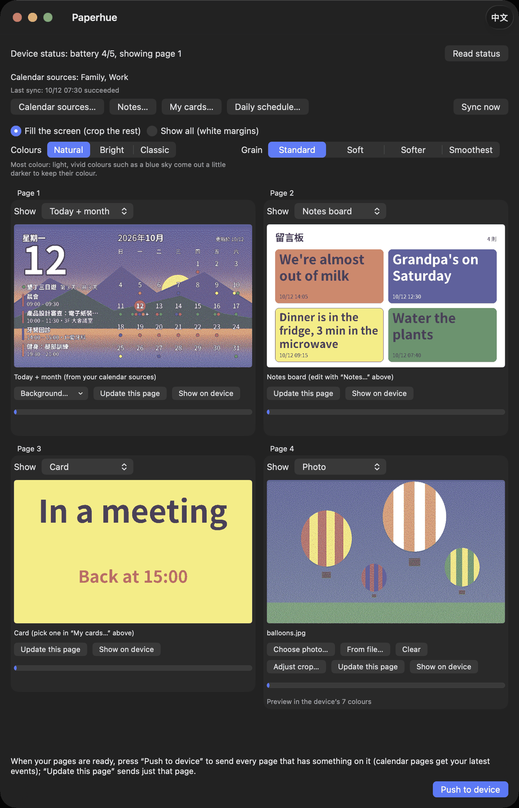

1. **Download and open.** Download
   [Paperhue-macOS.zip](https://github.com/markhhm/ulani-epaper/releases/latest/download/Paperhue-macOS.zip)
   (macOS 14 or newer, Apple silicon or Intel), unzip it and move
   **Paperhue** to **Applications**. Paperhue is not notarized by Apple, so
   macOS stops it the first time:
   - macOS 14: Control-click (or right-click) **Paperhue**, choose **Open**,
     then click **Open** again.
   - macOS 15 or newer: open it once and click **Done** in the message
     (not **Move to Trash**), then go to **System Settings → Privacy &
     Security**, scroll down to “Paperhue” was blocked to protect your Mac.,
     click **Open Anyway**, and click **Open Anyway** again in the window
     that follows (macOS may ask for your password or Touch ID).

   macOS remembers this; after that Paperhue opens like any other app.
2. **Bluetooth.** When Paperhue first connects, macOS asks whether it may use
   Bluetooth: click **Allow** (to change it later: **System Settings →
   Privacy & Security → Bluetooth**). Click **Read status**: when the top
   line shows the battery and the page on screen, you are ready. If the device
   is not found the first time, hold its button for about 5 seconds until the
   light blinks green (pairing mode), then click **Read status** again. The
   device remembers
   [one phone or computer at a time](#2-pair-the-device-with-the-pc): if it
   has been paired with another one since, forget it in **System Settings →
   Bluetooth**, then put it in pairing mode and click **Read status** again.
3. **Photos.** On a photo page, click **Choose photo…** (your Photos library)
   or **From file…** (an image file), or click the preview. **Adjust crop…**
   (or a double-click on the preview) chooses the part that fills the screen;
   **Fill the screen**, **Show all** and **Grain** work as on Windows (see
   [Putting photos on the device](#putting-photos-on-the-device)). You can
   also drag photos onto the window (they go to the photo pages; with more
   photos than photo pages, Paperhue asks first) or onto one page.
4. **Calendar, notes and cards.** **Calendar sources…**: give a source a
   name (or leave it empty to use the calendar's own), paste its iCal
   address, pick a colour and click **Check and add**. **Edit…** changes a
   source (**Check and save**), **Remove** deletes it. The address is kept
   only in this Mac's Keychain, and only its host name is shown. With no
   source, the calendar pages show Taiwan holidays. **Notes…**: write a note,
   pick its colour and click **Add note**; delete or clear notes there too.
   **My cards…** makes cards and puts them on card pages as on Windows (see
   [Cards](#cards)). A calendar page can also sit on one of your photos:
   **Background…** on its tile (the text is then drawn white with a black
   outline).
   Choosing photos, page kinds, backgrounds, sources, notes or cards only
   saves them and updates the previews: nothing reaches the device until you
   push.
5. **Push.** **Push to device** sends every page with content in one
   connection, the page on screen last, about 2 minutes in all: photo pages
   with a photo, calendar pages (read from your sources first; if they can't
   be read, those pages are left out with a warning and the rest still goes),
   notes pages and card pages with a card. **Sync now** updates only the
   calendar pages, and the line under the calendar sources shows how the
   last sync went. **Daily schedule…** does that every day at times you
   choose: it is off until you add at least one time (**Add this time**) and
   click **Turn on / update**. The Mac must be on and logged in, and a time
   missed while it slept is made up once when it wakes. If macOS asks, allow
   Paperhue in **System Settings → General → Login Items**.
6. **One page.** **Update this page** sends only that page (a calendar page
   reads your sources first). **Show on device** switches the device to that
   page, like pressing its button: nothing is sent, and the screen takes about
   40 seconds to redraw.

## Troubleshooting

When something goes wrong, Paperhue shows a pop-up titled "Push failed",
"Sync failed", "Couldn't read the status" or "Couldn't switch the page"
("Couldn't show the page on the device" on a Mac). The
first line explains the problem in the app's language; the technical details
under it are in English (a rare unexpected error shows only the English
text). Look up the first words here. A photo that Paperhue cannot open shows
"Can't read …" under its page instead.

| Message | What to do |
|---|---|
| The device isn't paired with this computer (on a Mac: This computer is no longer paired with the device) | Pair the device as described in [step 2](#2-pair-the-device-with-the-pc); if it was paired before, remove it in Windows' Bluetooth settings first. On a Mac, forget the device in **System Settings → Bluetooth**, put it in pairing mode and click **Read status**. |
| Can't find or connect to the device | Bring the device near the computer, check that the computer's Bluetooth is on and that the device is paired with this computer, and make sure no other phone or computer is connected to it right now. Then push again. |
| Bluetooth is off, or this app isn't allowed to use it (Mac) | Turn Bluetooth on, and allow Paperhue in **System Settings → Privacy & Security → Bluetooth**. |
| The device didn't respond | It is probably still refreshing its screen (about 40 seconds). Wait a minute and push again. |
| The device says the data it received was damaged | Push again. |
| The Bluetooth connection dropped | Move the computer closer to the device and push again. |
| Can't read … (under a page) | The file is damaged or in a format Paperhue cannot open (convert HEIC to JPG). |
| This photo is over the 50-megapixel limit | Shrink the photo, then choose it again. |
| Can't read the calendar sources | Check the internet connection. If the source's address was reset, paste the new one with **Calendar sources…** → **Edit…**. The details name the source and the HTTP error. |

More tips:

- The device sends a Bluetooth signal only now and then to save battery.
  Paperhue keeps trying for about two minutes before it gives up, so
  "Device status: connecting…" or "Connecting and pushing…" can stay on
  screen for a while. If it gives up (a pop-up appears; after **Read
  status** the top line says "Device status: unreachable"), try again.
- If a push stops half-way, push again: pages that already hold their photo
  are skipped.
- If the device shows a different page after a push, press its button to
  go to the page you want.
- The device remembers one phone or computer at a time. If the PC cannot
  connect any more after the device was paired with another phone or
  computer, remove the device in Windows' Bluetooth settings, put the device
  in pairing mode and pair it again (see
  [step 2](#2-pair-the-device-with-the-pc)).

Still stuck? Open an issue on
[GitHub](https://github.com/markhhm/ulani-epaper/issues) and include the
message Paperhue showed.

## Privacy

Paperhue needs no account and uses no cloud service. Your photos and notes
never leave your computer or phone, except over the Bluetooth link to your
own device.

On a computer, the only internet access is downloading the calendar
addresses you add (or, with none, the public Taiwan holidays calendar).
Each address works like a password, so Paperhue keeps it in the Windows
Credential Manager, not in a file, and shows only its host name (for
example calendar.google.com). Events and to-dos are downloaded, drawn and
sent to the device in memory; nothing from your calendars is saved on the
computer. The sync log keeps only the time, the outcome and how many events,
to-dos and notes there were. Your notes themselves are kept on the computer
(in `%APPDATA%\ulani-epaper\notes.json`) so that the board can be redrawn,
your cards in `cards.json` and the photos you chose for cards and calendar
pages in the `backgrounds` folder, and your settings, including the
language and any daily sync times, all in the same folder. On a Mac, the
addresses are in the Keychain, and the notes, cards, the photos chosen for
cards and calendar pages, and the settings in the app's own container
(`~/Library/Containers/io.github.markhhm.paperhue`). On a phone, cards,
photos and settings stay in Paperhue on that phone (on an iPhone, in
Bluefy's website storage: see [Good to know](#good-to-know)); the phone's
calendars are read only while the pages are drawn, and nothing from them is
saved.

## For developers

Paperhue for Windows is built on a small Python library, `ulani-epaper`,
which you can use in your own scripts (Python 3.10–3.14):

```
pip install "ulani-epaper @ git+https://github.com/markhhm/ulani-epaper#subdirectory=python"
```

```python
import asyncio
from ulani_epaper.push import push_images

# photo n goes to page n; None leaves that page alone
asyncio.run(push_images(["a.jpg", "b.jpg", None, "d.jpg"]))
```

It also installs the `ulani` command-line tool (`ulani push`, `ulani send`,
`ulani text`, `ulani info`, …); `ulani note` posts to the message board,
`ulani card` lists, adds, pushes, preloads, exports and imports cards, and
`--crop` on `ulani send` and `ulani push` chooses the part of a photo to
show. The command line's own messages are in English. The calendar pages
(`ulani feeds`, `ulani sync`, `ulani schedule`) need the `calendar` extra:

```
pip install "ulani-epaper[calendar] @ git+https://github.com/markhhm/ulani-epaper#subdirectory=python"
```

[python/README.md](python/README.md) covers the API, the command-line tool,
tests and building Paperhue.exe; [web/README.md](web/README.md) the phone
app; [apple/DEVELOPING.md](apple/DEVELOPING.md) the Mac app;
[shared/PROTOCOL.md](shared/PROTOCOL.md) describes the Bluetooth protocol.

| Folder | Contents |
|---|---|
| [`python/`](python/) | the `ulani-epaper` library, the `ulani` command-line tool and the Paperhue Windows app |
| [`web/`](web/) | the phone app: the web page for iPhone (Bluefy) and the Android app |
| [`apple/`](apple/) | the Paperhue Mac app and its Swift library |
| [`shared/`](shared/) | protocol notes, the page and card specs, test vectors and reference renders shared by all the apps |
| [`docs/`](docs/) | the calendar guide and images for the READMEs |

## License

MIT, see [LICENSE](LICENSE). The calendar pages are drawn with a subset of
Noto Sans CJK TC, under the SIL Open Font License 1.1
([python/src/ulani_epaper/fonts/OFL.txt](python/src/ulani_epaper/fonts/OFL.txt)).

ULANI is a trademark of its respective owner. Paperhue is an independent
open-source project and is not affiliated with, endorsed by or sponsored by
ULANI.
