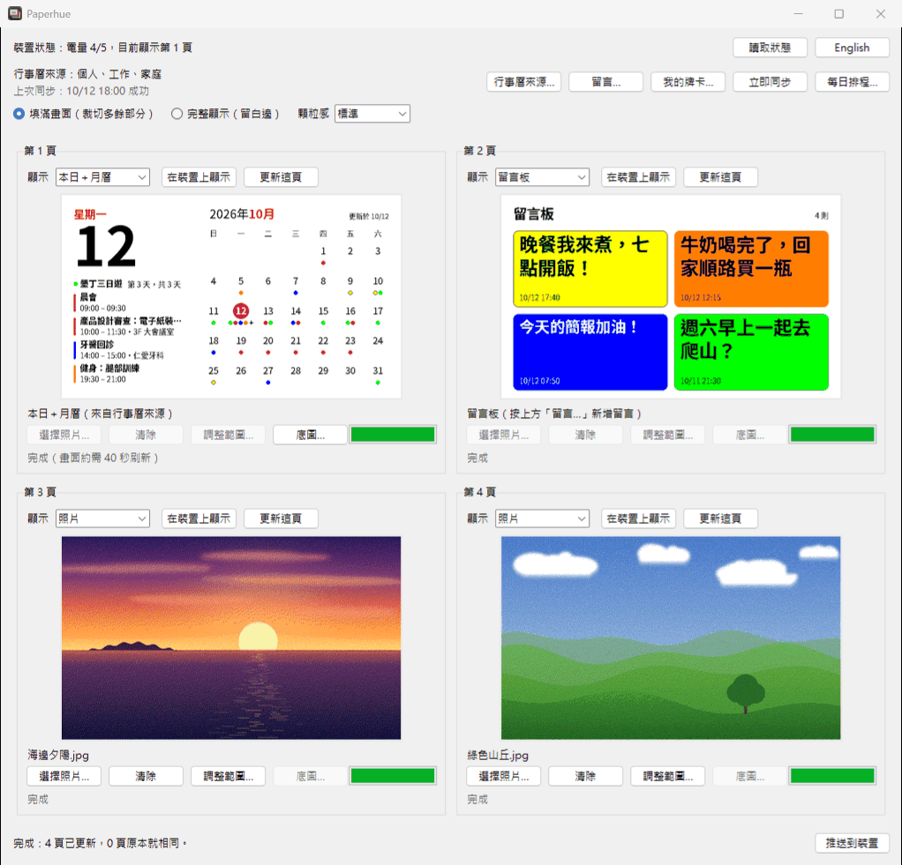
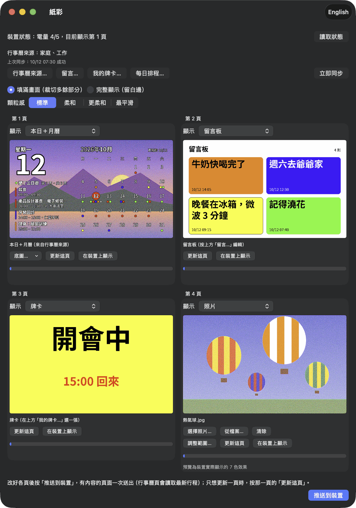
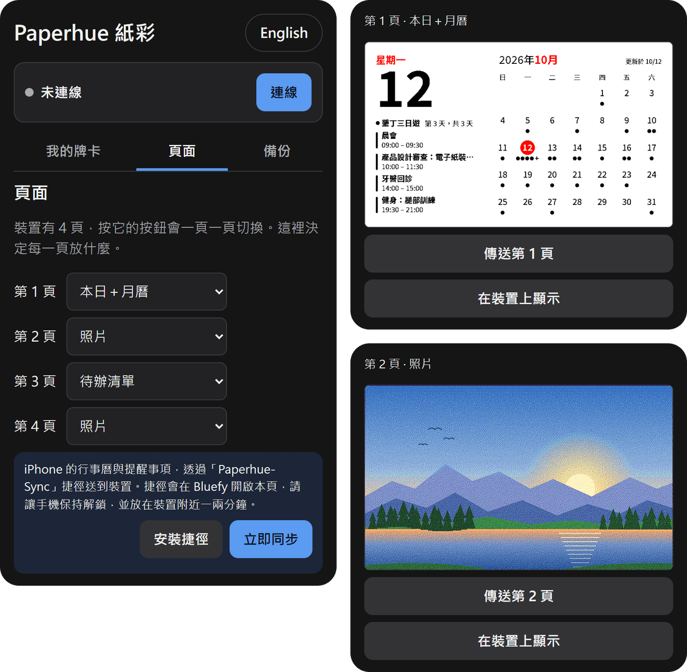

<p align="center"></p>

# 紙彩 Paperhue — 讓你的 ULANI 永恆曆真的永恆

[English](README.md) | 繁體中文

永恆曆就該跟裝置一樣長久。紙彩完全開放原始碼，不需要帳號，也沒有自己的伺服器：你的電腦或手機直接用藍牙和裝置溝通；程式碼公開，任何人都能一直建置、使用下去。支援 Windows、Mac、iPhone（透過 Bluefy 瀏覽器）與 Android。

**紙彩（Paperhue）** 可以把你自己的照片、行事曆與待辦事項、簡短的留言，還有你自己設計的牌卡放到
**ULANI 七色電子紙裝置**上。最多可以選四張照片，自己決定每張照片要顯示哪一部分，先看它們在七色電子紙上的效果，
再透過藍牙傳到裝置；任何一頁也可以改成行事曆頁（本日＋月曆、本日行程＋一週行程、待辦清單等），內容來自你自己的行事曆，
可手動或每天定時更新；也可以改成留言板，顯示你寫的留言；或是一張牌卡：照片或純色背景上的狀態、迷因或名言。不需要帳號、不用登入，中間也不經過任何雲端服務。
程式介面有繁體中文和 English 兩種語言。



## 功能

裝置可以存四頁畫面，用按鍵切換。每一頁可以放：

- **照片**：紙彩把你選的照片縮放成 800 × 480、轉換成面板的七種顏色，
  再透過藍牙（Bluetooth LE）傳到你指定的那一頁。你可以移動、縮放要顯示的照片範圍。紙彩的預覽只用這七種顏色呈現，而且用的是面板實際顯示、比螢幕柔和的色調，傳送前就能看出效果。
- **行事曆頁**：「本日＋月曆」「本日行程＋一週行程」「待辦清單」「日」或「月曆」，內容來自你的行事曆（見[行事曆頁](#行事曆頁)）。
- **留言頁**（Windows 與 Mac 版）：「留言板」或「大字留言」，顯示你在紙彩寫的留言（見[留言板](#留言板)）。
- **牌卡**：你在紙彩裡做的一張圖，背景是一張照片（可以調整範圍）或七種顏色之一，上面放幾個文字框，
  例如「開會中，15:00 回來」這類狀態、配上一句話的迷因圖，或是一句名言（見[牌卡](#牌卡)）。

## 下載

**[下載 Paperhue.exe](https://github.com/markhhm/ulani-epaper/releases/latest/download/Paperhue.exe)**（最新版）

- Windows 10 或 11，電腦需要支援藍牙低功耗（Bluetooth LE）。大部分筆電都有內建；桌上型電腦可能要另外接藍牙 4.0 以上的 USB 接收器。
- 只有一個檔案，不需要安裝：存到任何地方，按兩下就能開啟，見 [Windows](#windows)。

**Mac**：[下載 Paperhue-macOS.zip](https://github.com/markhhm/ulani-epaper/releases/latest/download/Paperhue-macOS.zip)（macOS 14 以上），見 [Mac](#mac)。

**iPhone**：不用下載。用 Bluefy 瀏覽器開啟紙彩即可，見 [iPhone](#iphone)。

**Android**：[下載 Paperhue-Android.apk](https://github.com/markhhm/ulani-epaper/releases/latest/download/Paperhue-Android.apk)（Android 7 以上），見 [Android](#android)。

## 中文或 English

紙彩第一次開啟時會跟著電腦或手機的語言：設成中文就用繁體中文，其他一律用 English。
上方列的語言按鈕會顯示「另一種」語言（目前是中文時顯示「**English**」，是 English 時顯示「**中文**」）；
按一下，所有文字（包括已經開著的視窗）立刻換成另一種語言，照片和進行中的推送都不會受影響。
紙彩會記住你的選擇。在 Mac 上，選單列會在下次開啟紙彩時跟著換。本說明用中文介面的標籤；English 介面的標籤見 [README.md](README.md)。
畫在裝置上的頁面（行事曆頁與留言頁）目前一律是中文。

## 在電腦上

紙彩在 Windows 和 Mac 上的用法相同：照下面設定好你的電腦，之後的章節兩者通用。

### Windows

#### 1. 讓 Windows 開啟紙彩

下載時瀏覽器可能會先提示這個檔案不常被下載，請選「**保留**」（Edge 要先按下載項目旁的「…」）。

Paperhue.exe 沒有數位簽章，第一次開啟時 Windows 可能會顯示「**Windows 已保護您的電腦**」。
請按「**其他資訊**」，再按「**仍要執行**」。

#### 2. 將裝置與電腦配對

裝置只會和配對過的電腦連線。

1. 長按裝置按鍵約 5 秒，直到 LED 綠燈閃爍（配對模式）。
2. 在電腦上開啟「**設定 → 藍牙與裝置 → 新增裝置 → 藍牙**」（Windows 10：「**設定 → 裝置 → 新增藍牙或其他裝置 → 藍牙**」），選擇名稱以 **ULANI Calendar** 開頭的裝置。
   Windows 11 若清單裡找不到裝置，請到「**設定 → 藍牙與裝置 → 裝置**」，把「**藍牙裝置探索**」設為「**進階**」，再讓裝置重新進入配對模式後重試。
3. 開啟紙彩，按「**讀取狀態**」。上方的「裝置狀態」出現電量和目前顯示的頁數（例如「裝置狀態：電量 4/5，目前顯示第 1 頁」；
   顯示「充電中」表示正在充電），就代表可以開始使用了。

**一次只記得一支手機或電腦**：裝置只記得最後配對的那一支手機或那一台電腦，和另一支手機或電腦配對後，就會忘記先前的配對。
要換回來，請在那支手機或那台電腦的藍牙設定移除（忘記）裝置，讓裝置進入配對模式（長按按鍵約 5 秒，直到綠燈閃爍），再重新配對。

### Mac

在 Mac 上，紙彩能做的和 Windows 版一樣：把照片、行事曆頁、留言和牌卡放到裝置上。每一頁的「**顯示**」選單可選「**照片**」「**本日＋月曆**」
「**本日行程＋一週行程**」「**待辦清單**」「**日**」「**月曆**」「**留言板**」「**大字留言**」或「**牌卡**」
（見[行事曆頁](#行事曆頁)、[留言板](#留言板)和[牌卡](#牌卡)）。



1. **下載並開啟。** 下載 [Paperhue-macOS.zip](https://github.com/markhhm/ulani-epaper/releases/latest/download/Paperhue-macOS.zip)
   （macOS 14 以上，Apple 晶片或 Intel 都可以），解壓縮後把 **Paperhue** 拖進「**應用程式**」。
   紙彩沒有經過 Apple 公證，所以第一次開啟時 macOS 會擋下來：
   - macOS 14：按住 Control 點一下（或按右鍵）**Paperhue**，選「**打開**」，再按一次「**打開**」。
   - macOS 15 以上：先開一次，在提示上按「**完成**」（不要按「丟到垃圾桶」），再到「**系統設定 → 隱私權與安全性**」，
     往下捲到「已阻擋「Paperhue」以保護你的Mac。」，按「**強制打開**」，在接著跳出的視窗再按一次「**強制打開**」
     （macOS 可能會要你輸入密碼或使用 Touch ID）。

   macOS 會記住這個選擇，之後就能像一般 App 一樣開啟。
2. **藍牙。** 紙彩第一次連線時，macOS 會詢問是否允許使用藍牙，請按「**允許**」
   （之後要改：「**系統設定 → 隱私權與安全性 → 藍牙**」）。按「**讀取狀態**」，上方出現電量和目前顯示的頁數，就可以開始使用了。
   如果第一次找不到裝置，請長按裝置按鍵約 5 秒，直到綠燈閃爍（配對模式），再按一次「**讀取狀態**」。
   裝置[一次只記得一支手機或電腦](#2-將裝置與電腦配對)：如果之後和別的手機或電腦配對過，請先到「**系統設定 → 藍牙**」忘記這個裝置，
   再讓裝置進入配對模式，按一次「**讀取狀態**」。
3. **照片。** 在照片頁按「**選擇照片…**」（從「照片」圖庫挑選）或「**從檔案…**」（選一個圖片檔），或點預覽區。
   「**調整範圍…**」「**填滿畫面**」「**完整顯示**」「**顏色**」和「**顆粒感**」的用法和
   Windows 版相同（見[把照片放到裝置上](#把照片放到裝置上)）。也可以把照片拖到視窗上（會放到照片頁；照片比照片頁多時，紙彩會先問你），
   或拖到某一頁上。
4. **行事曆、留言與牌卡。** 用法和[行事曆頁](#行事曆頁)、[留言板](#留言板)、[牌卡](#牌卡)相同。
   「**行事曆來源…**」：填名稱（留空就用行事曆自己的名稱）、貼上 iCal 網址、選顏色，按「**檢查並加入**」。
   「**編輯…**」可以修改來源（改好按「**檢查並儲存**」），「**移除**」刪除來源。
   網址只存在這台 Mac 的鑰匙圈，畫面上只顯示網站名稱。
   更新紙彩之後，macOS 會為每個行事曆來源詢問一次是否允許紙彩使用：輸入 Mac 的密碼，再選「**永遠允許**」。
   選「**拒絕**」的話，下次讀到那個來源時會再問一次。如果先跑的是每日排程，詢問視窗上的名稱會是「Paperhue」，同步會等你回答後才繼續。
   選照片、換頁面種類、選底圖、加來源、寫留言，或在「**我的牌卡…**」幫牌卡頁選牌卡（見[牌卡](#牌卡)），都只會存檔並更新預覽，按推送之前不會傳到裝置。
5. **推送。** 「**推送到裝置**」一次送出所有有內容的頁面：有照片的照片頁、行事曆頁、留言頁，以及已放上牌卡的牌卡頁。
   推送、「**更新這頁**」和「**在裝置上顯示**」的用法和 Windows 版相同（見[把照片放到裝置上](#把照片放到裝置上)），
   「**立即同步**」和「**每日排程…**」也一樣（見[行事曆頁](#行事曆頁)），只是每日排程的時間要用「**加入這個時間**」加入。
   Mac 需要開機並登入；睡眠時錯過的時間，會在醒來後補做一次。如果 macOS 要求，請到「**系統設定 → 一般 → 登入項目**」允許紙彩。

### 把照片放到裝置上

1. 在每一頁（「**第 1 頁**」到「**第 4 頁**」）按「**選擇照片…**」（Mac 版還有「**從檔案…**」）或點預覽區，選一張照片。
   支援 JPG、PNG、BMP、GIF、WebP、TIFF；HEIC 請先轉成 JPG。
   沒有選照片的頁面，裝置上會維持原樣。按「**清除**」可以取消那一頁選的照片（不會清掉裝置上的畫面）。
   每一頁上方的「**顯示**」選單決定這頁放什麼：「照片」、行事曆頁、留言頁或「牌卡」。照片只會放在設為「照片」的頁面；
   預設只有第 4 頁是照片（第 1–3 頁是行事曆頁），要放照片的頁面請先改成「照片」。
2. 在頁面上方選擇選項（所有照片頁共用）：
   - 「**填滿畫面（裁切多餘部分）**」：照片填滿 5:3 的畫面，這是預設選項；要顯示哪一部分可用「**調整範圍…**」決定（見下方）。
   - 「**完整顯示（留白邊）**」：整張照片都放進畫面，多出的地方留白。
   - 「**顏色**」：照片的顏色怎麼對應到面板的顏色。「**自然**」（預設）在面板做得到的範圍內，盡量保留照片原本的顏色和明暗；
     「**經典**」是紙彩 0.3 版較淡、較亮的樣子。選「**自然**」時，「**顆粒感**」會改為「**標準**」，之後仍可再調整。
   - 「**顆粒感**」：用七種顏色交錯出細緻色調的程度。「**標準**」（預設）細節最多；
     「**柔和**」「**更柔和**」「**最平滑**」顆粒較少、畫面較平靜，但色帶會比較明顯。

   「**顏色**」和「**顆粒感**」也會套用在行事曆頁的底圖和牌卡上的照片。

   幾秒後預覽就會更新成七色效果，下方顯示「預覽為裝置實際顯示的 7 色效果」（顯示「產生預覽中…」時請稍候）；所有預覽完成後才能按「**推送到裝置**」。
3. 按「**推送到裝置**」，一次送出所有有內容的頁面：有照片的照片頁、行事曆頁（會先讀取你的行事曆）、留言頁，
   以及在「**我的牌卡…**」選好牌卡的牌卡頁。每一頁會各自顯示進度：等待中 · 準備傳送（1/4） · 傳送中 37% ·
   內容沒有變化，略過 · 完成（畫面約需 40 秒刷新） · 未完成。全部結束後，下方會顯示例如「完成：3 頁已更新，1 頁原本就相同。」

選照片、調整範圍、改頁面種類與底圖、寫留言、選牌卡，都只會改變紙彩裡的預覽；按推送之前不會傳到裝置，
所以可以全部改完再一次推送。每一頁上方的「**更新這頁**」只送那一頁。
（在「**我的牌卡…**」按牌卡下方的「**放到第 N 頁**」，就會把它放到那個牌卡頁；有好幾個牌卡頁時，按「**放到…**」再選一頁。）

裝置上正在顯示的那一頁會最後傳，所以面板只會刷新一次，裝置也會停在原本顯示的那一頁。每頁通常約 25–30 秒（藍牙較慢時可能到 50 秒左右），
四頁全部大約 2 分鐘；裝置上已經是同一張圖的頁面會自動略過。讀不到行事曆時（例如沒有網路），其他頁面仍會送出，
下方會說明行事曆頁這次沒有更新。下方出現「**完成**」之前，請不要關閉紙彩；
之後裝置還需要約 40 秒刷新畫面。其他頁面一樣存在裝置裡，按裝置按鍵就能切換過去。
傳送中關閉紙彩時，會先問「還在傳送到裝置，現在關閉會中斷傳送。確定要關閉嗎？」；關閉會中斷推送，之後再推送一次即可。

**小技巧：** 把最多四張照片拖到 **Paperhue.exe** 的檔案圖示上（不是已開啟的視窗），紙彩開啟時會把它們放在照片頁；照片比照片頁多時，會問你要不要把其他頁改成照片。順序由 Windows 決定，推送前請確認每一頁。在 Mac 上則是把照片拖到視窗上（見 [Mac](#mac)）。

#### 選擇照片要顯示的部分

選了「**填滿畫面（裁切多餘部分）**」後，按照片下方的「**調整範圍…**」（或在預覽上按兩下），就能決定哪一部分要放滿畫面。
視窗會顯示整張照片，範圍以外的地方會變暗：

- 在框內拖曳可以移動範圍；
- 拉四角、滾動滑鼠滾輪，或拉下方的「**縮放**」滑桿，可以縮小或放大範圍（範圍永遠維持畫面的 5:3 比例）；
- 方向鍵可以微調（加 Shift 加快）；
- 「**重設**」回到置中的範圍，「**取消**」維持原狀，「**確定**」套用你的選擇並更新預覽。

每一頁選好的範圍會保留到你換另一張照片，或關閉紙彩為止。選「**完整顯示（留白邊）**」時不會用到範圍，但也不會被忘記。

#### 太大的照片

超過 **5000 萬像素**的照片（例如寬高超過約 8000 × 6250）不會被接受，那一頁會顯示「照片超過 5000 萬像素的上限，請先縮小再選。」
其他照片在紙彩開啟時，會先縮小到 4K 以內（橫式照片 3840 × 2160，直式 2160 × 3840）。
這比 800 × 480 的畫面需要的大很多，所以效果看起來一樣，預覽與調整範圍也比較快。
本來就在範圍內的照片維持原樣，紙彩也不會把照片放大。

#### 切換裝置顯示的頁面

每一頁上方的「**在裝置上顯示**」會讓裝置切換到那一頁，就像按裝置的按鈕一樣。不會傳送任何內容，畫面重畫約需 40 秒。

### 行事曆頁

任何一頁都可以顯示你自己的行事曆，風格像手機的小工具：

| 本日＋月曆 | 本日行程＋一週行程 | 待辦清單 |
|---|---|---|
|  |  |  |
| **日** | **月曆** | |
|  |  | |

- **本日＋月曆**：左邊是今天的日期與行程，右邊是小月曆，有行程的日子會有彩色圓點。
- **本日行程＋一週行程**：接下來的行程、今天其他的行程，以及之後六天。
- **待辦清單**：還沒完成的待辦，逾期的以紅色標示。
- **日**：大大的日期、星期，以及今天的行程。
- **月曆**：整個月的格狀月曆，星期日是紅色，有行程的日子會有彩色圓點和簡短標題。

行事曆頁也可以放在自己的照片上：在那一頁按「**底圖…**」再選一張照片（文字會改成白字黑框）。
手機版在「**頁面**」裡，行事曆頁下方的「**背景照片**」也能這樣做。

完全沒有行事曆來源時，行事曆頁會顯示台灣的公共假日。

內容來自你的行事曆的 **iCal（.ics）網址**，例如 Google 日曆的「iCal 格式的私密網址」或 Outlook 發佈的行事曆。
紙彩只是下載這些網址，跟訂閱行事曆一樣：不用 Google 或其他公司的 API、不用建立雲端專案、不用授權登入。

1. 按「**行事曆來源…**」→「**新增…**」，填名稱（顯示在頁面上，例如「個人」）、貼上網址、選顏色，
   再按「**檢查並儲存**」（Mac 版是「**檢查並加入**」）。紙彩會先下載一次，並告訴你近期有幾個行程、幾項待辦。可以加好幾個來源，每個來源一種顏色。
2. 把各頁的「**顯示**」選單設成上面任一種行事曆頁。
3. 按「**立即同步**」馬上更新；或按「**每日排程…**」，讓 Windows「工作排程器」每天定時更新（例如早上一次、下午一次）。
   在你填入至少一個時間並按「**啟用／更新排程**」之前，排程是關閉的（視窗顯示「目前：未啟用」）；按「**停用排程**」就會取消。
   電腦需要開機並登入 Windows；關機或睡眠時錯過的時間，會在下次開機後補做（Mac 的情形見 [Mac](#mac)）。
   行事曆來源下方那一行會顯示上次同步的結果，例如「上次同步：10/12 18:00 成功」。

私密網址就像密碼：拿到的人就能看到那整本行事曆，所以只貼到紙彩裡就好。紙彩把它存在 Windows 認證管理員或 Mac 的鑰匙圈（不是一般檔案），
畫面上只顯示主機名稱（例如 calendar.google.com）。紙彩只讀取你的行事曆，下載的內容也不會存在電腦上。

內容沒變的頁面會自動略過，面板不會白白重刷。Google 日曆、Apple iCloud、Outlook 等的網址在哪裡、哪些待辦服務可以用、
來源失效時怎麼處理，見 [docs/CALENDARS.md](docs/CALENDARS.md)。

### 留言板

也可以用一頁來放簡短的留言，給經過的家人看：

| 留言板 | 大字留言 |
|---|---|
|  |  |

- **留言板**：最新的六則留言，像一張張彩色便利貼，各自附上寫下的時間。
- **大字留言**：只放最新的一則，字放到最大。

1. 把某一頁的「**顯示**」選單設成「留言板」或「大字留言」。還沒設定時，留言視窗會顯示「還沒有留言頁」，
   在 Windows 上「**新增留言**」也無法按。
2. 按「**留言…**」，寫下留言（最多 300 字、8 行），選顏色（黃、橘、綠、藍、紅），再按「**新增留言**」。留言頁的預覽會立刻更新。
3. 按「**推送到裝置**」，或留言頁上的「**更新這頁**」，把留言送到裝置。想讓裝置切換到留言頁，按那一頁的「**在裝置上顯示**」。

新增留言不需要網路。同一個視窗下方列出已新增的留言（最新的在最上面）：點選一則再按「**刪除**」，或按「**全部清除**」；
和新增留言一樣，下次推送時才會更新到裝置。

紙彩會在電腦上保留最新的 50 則留言。傳送失敗時，留言仍然會保存；等裝置在附近時再推送一次
（或執行 `ulani note push`）即可。「**立即同步**」和每日排程只會更新行事曆頁，不會重畫留言頁。

### 牌卡

牌卡是你在紙彩裡自己做的一張圖：背景是一張照片或七種顏色之一，上面最多放 8 個文字框。可以用來放狀態、迷因圖或一句名言：

| 純色背景的狀態 | 照片上的迷因圖 |
|---|---|
|  |  |
| **名言與出處** | **一個文字框寫好幾行** |
|  |  |

1. 按「**我的牌卡…**」，再按「**新增牌卡…**」。在「**背景**」選一種顏色，或按「**照片…**」選照片，再用「**調整範圍…**」決定要顯示的部分。
   按「**新增文字框**」加入文字（每個最多 80 字）：拖曳文字框可以移動，拉四角可以改大小，
   再設定「**字級**」（也可以用滑鼠滾輪）、「**文字顏色**」、「**外框**」和「**對齊**」。預覽就是裝置實際顯示的七色效果。最後按「**儲存**」。
2. 把某一頁的「**顯示**」選單設成「牌卡」，再到「**我的牌卡…**」按那張牌卡下方的「**放到第 N 頁**」
   （有好幾個牌卡頁時，按「**放到…**」再選一頁；還沒有牌卡頁時，紙彩會問你要不要把一頁改成牌卡頁）。
3. 按「**推送到裝置**」，或牌卡頁上的「**更新這頁**」，把牌卡送到裝置。按推送之前不會傳到裝置。

有好幾個牌卡頁時，可以每頁放一張不同的牌卡，一次推送；之後按那一頁的「**在裝置上顯示**」就能切換，不用再傳送。
「**立即同步**」和每日排程不會改動牌卡頁。

在「**我的牌卡…**」勾選牌卡，再按「**編輯…**」「**複製**」「**刪除**」或「**匯出…**」。「**匯出…**」把牌卡連同照片存成一個 `.paperhue-card` 檔，
「**匯入…**」加入這種檔案：牌卡就是這樣在 Windows、Mac、iPhone 和 Android 版的紙彩之間搬移。

在手機上，牌卡在「**我的牌卡**」分頁：按「**新增牌卡**」做一張，點一下牌卡就會把它送到牌卡頁並讓裝置切換過去，
「**預載到裝置**」則一次把幾張牌卡放進牌卡頁，不切換畫面。「**存成牌卡檔**」（在編輯畫面）和「**匯入牌卡檔**」用來在不同的紙彩之間搬移牌卡。

## 在手機上

iPhone 和 Android 用的是同一個 App：「**頁面**」決定每一頁放什麼，「**我的牌卡**」放牌卡（見[牌卡](#牌卡)）。

### iPhone

在 iPhone 上，紙彩是一個網頁，要用免費的 **Bluefy** 瀏覽器開啟（Safari 不能使用藍牙）。你可以做牌卡
（一句短短的話、「下午 3 點回來」這類狀態、一句名言或一張迷因圖）、把照片放到裝置上，也可以讓行事曆頁直接讀取
iPhone 上本來就有的「行事曆」與「提醒事項」，不用貼上任何網址。手機必須在裝置附近，因為唯一的連線方式是藍牙。
「**頁面**」列出裝置的四頁：決定每一頁放什麼、幫照片頁選照片並傳送，按「**在裝置上顯示**」讓裝置切換到那一頁；牌卡則從「**我的牌卡**」傳送。
「**顏色**」和「**顆粒感**」的用法和 Windows 版相同（見[把照片放到裝置上](#把照片放到裝置上)）。



#### 1. 設定 Bluefy

1. 從 App Store 安裝 **Bluefy**。
2. 在 Bluefy 開啟 **<https://markhhm.github.io/ulani-epaper/>**，並加入書籤。
3. 長按裝置按鍵約 5 秒，直到 LED 綠燈閃爍（配對模式）。在網頁上按「**連線**」，選擇名稱以 **ULANI Calendar**
   開頭的裝置，並接受配對要求。網頁上方出現電量，就代表可以開始使用了。
   裝置[一次只記得一支手機或電腦](#2-將裝置與電腦配對)：如果之後和別的手機或電腦配對過，請先到 iPhone 的「**設定 → 藍牙**」忘記這個裝置，再做一次這個步驟。

#### 2. 用捷徑同步行事曆

**Paperhue-Sync** 捷徑會讀取 iPhone 上所有行事曆未來 45 天的行程，以及尚未完成的提醒事項，然後在 Bluefy 開啟紙彩。
網頁會自己找到已配對的裝置（不用再按任何按鈕），畫出設成行事曆頁的那幾頁，只傳送有變動的頁面，最後告訴你結果。
牌卡、照片和留言頁不會被動到。

1. 在 **Safari** 開啟
   [Paperhue-Sync.shortcut](https://markhhm.github.io/ulani-epaper/shortcuts/Paperhue-Sync.shortcut)，
   按「**加入捷徑**」。如果只是下載了檔案，請到「**檔案 → 下載項目**」開啟它。請保留它的名稱
   **Paperhue-Sync**：紙彩的「**立即同步**」按鈕就是找這個名稱；如果名稱不同，請在「捷徑」App 裡長按它，選「**重新命名**」。
2. 先手動執行一次。它詢問是否允許存取「行事曆」「提醒事項」，以及開啟 Bluefy 時，請選「**永遠允許**」，
   之後執行就不會再問。
3. 之後只要想更新行事曆頁，就在 Bluefy 開啟紙彩，到「**頁面**」按「**立即同步**」。（同一頁的「**安裝捷徑**」就是步驟 1 的連結。）

#### 3. 在設定的時間自動更新（選用）

在你設定時間之前，都是手動更新。請在「**捷徑**」App 裡：

1. 開啟「**自動化**」分頁，按「**＋**」，選「**一天中的時間**」。
2. 選一個手機通常在裝置附近的時間（例如早上一次、下午一次；每個時間各做一個自動化），重複設為「**每天**」，按「**下一步**」。
3. 加入動作「**執行捷徑**」，選擇 **Paperhue-Sync**，按「**下一步**」。
4. 選擇執行方式：
   - 「**立即執行**」：到時間就自己開始。
   - 「**確認後執行**」（部分 iOS 版本稱為「**執行前詢問**」）：到時間手機會跳出通知，點通知再按「**執行**」。

   以上是 iOS 17 與 18 的用詞，更新的 iOS 版本用詞可能略有不同，請找「自己開始」和「先詢問」這兩種選項。
5. 按「**完成**」。

#### 注意事項

- **手機必須解鎖。** 捷徑會開啟 Bluefy，網頁也需要螢幕亮著才能和裝置通訊。到時間時如果手機鎖著，這次同步可能不會執行，
  之後再按「**立即同步**」即可。
- **請留在裝置附近。** Bluefy 會在前景約 1 到 3 分鐘，執行期間螢幕會保持亮著。如果網頁約一分鐘內找不到裝置，
  就會放棄並告訴你，不會改動任何東西，之後再按「**立即同步**」重試。
- 如果你同時也在電腦上使用紙彩，只有最後配對的那一個連得上裝置：請只在那一個設定定時更新，而且每個都使用相同的頁面設定（哪一頁顯示什麼）。
  手機版沒有留言頁：電腦上顯示留言的那一頁，在手機上請設為「**照片**」且不放照片，手機就不會動到它。
- **請備份牌卡。** 牌卡、照片和設定只存在這支 iPhone 的 Bluefy 網站儲存空間，不會傳到任何伺服器。
  iOS 可能在你一段時間沒用這個瀏覽器、或你清除 Bluefy 的資料時，清掉網站的儲存內容。請偶爾開啟「**備份**」，
  按「**匯出備份**」，把檔案存在「**檔案**」或 iCloud Drive；需要時按「**匯入備份**」就能全部還原。
- 你的行事曆與提醒事項不會存在任何地方：捷徑本身不留任何資料，網頁只在開啟期間把它們放在記憶體裡。

### Android

在 Android 上，紙彩是一個 App，用法和 iPhone 版相同（見上方截圖）：牌卡在「**我的牌卡**」，每一頁放什麼（包括照片頁的照片）在「**頁面**」。它沒有上架 Google Play，請從這裡下載安裝。

1. **下載並安裝。** 在手機上下載 [Paperhue-Android.apk](https://github.com/markhhm/ulani-epaper/releases/latest/download/Paperhue-Android.apk)
   並開啟它。Android 會詢問是否允許你的瀏覽器（或「檔案」App）安裝應用程式：請允許，回到上一頁按「**安裝**」。
   新版本用同樣的方式直接覆蓋安裝，牌卡和設定都會保留。
2. **連線。** 長按裝置按鍵約 5 秒，直到 LED 綠燈閃爍（配對模式）。在紙彩按「**連線**」，允許「**鄰近裝置**」權限，
   選擇裝置並接受配對要求。裝置[一次只記得一支手機或電腦](#2-將裝置與電腦配對)：如果之後和別的手機或電腦配對過，
   請先到手機的藍牙設定忘記（取消配對）這個裝置，再照這個步驟重新連線。
3. **日曆權限。** 行事曆頁會顯示這支手機上的行事曆（「日曆」App 裡的所有帳號）。第一次開啟「**頁面**」時，
   Android 會詢問是否允許紙彩存取日曆：請選「**允許**」。如果當時拒絕了，可以在那裡按「**使用這支手機的行事曆**」，
   或到「**設定 → 應用程式 → Paperhue → 權限 → 日曆**」開啟。在「**iCal 網址**」可以加入不在手機上的行事曆和待辦清單（選用）。
   完全沒有行事曆時，頁面會顯示台灣的公共假日。
4. **定時同步（選用）。** 加入時間之前都不會自動同步：到「**頁面 → 定時同步**」加入一個或幾個時間，例如早上一次、下午一次。
   每到設定的時間，只要藍牙開著、手機在裝置附近，紙彩就會在背景更新行事曆頁，不必打開 App（執行時會顯示一則通知）。
   找不到裝置時，兩小時內每 15 分鐘再試一次，之後就略過這一次。最近幾次的結果列在時間下方。牌卡、照片和留言頁不會被動到。
5. **電池設定。** 加入第一個時間時，Android 會詢問是否讓紙彩一律在背景執行：請選「**允許**」，否則同步可能延後或被略過。
   之後要更改：「**設定 → 應用程式 → Paperhue → 電池 → 不受限制**」（各家手機的用詞略有不同）。

手機的行事曆只在畫頁面時讀取，不會被儲存；iCal 網址只存在這支手機的 App 裡。如果你同時也在電腦或 iPhone 上使用紙彩，
只有最後配對的那一個連得上裝置：請只在那一個設定定時更新，而且每個都使用相同的頁面設定（電腦上的留言頁，在手機上是不放照片的「**照片**」頁）。

## 疑難排解

出問題時，紙彩會跳出「推送失敗」「同步失敗」「讀取狀態失敗」或「切換頁面失敗」（Mac：「無法在裝置上顯示這一頁」）視窗；
第一行是中文說明，下方是英文的技術細節（少數意料之外的錯誤只會顯示英文訊息）。請依第一行開頭對照下表（照片無法開啟時，則會在那一頁下方顯示「無法讀取 …」）：

| 訊息 | 處理方式 |
|---|---|
| 裝置尚未與這台電腦配對（Mac：裝置與這台電腦的配對已失效） | 依[第 2 步](#2-將裝置與電腦配對)配對裝置；如果以前配對過，請先到 Windows 的藍牙設定移除裝置。在 Mac 上，請到「**系統設定 → 藍牙**」忘記這個裝置，讓裝置進入配對模式後按「**讀取狀態**」。 |
| 找不到裝置或連不上 | 把裝置拿近電腦，確認電腦藍牙已開啟、裝置已與這台電腦配對，而且現在沒有其他手機或電腦連著裝置，再推送一次。 |
| 藍牙未開啟或未允許本 App 使用藍牙（Mac） | 打開藍牙，並在「**系統設定 → 隱私權與安全性 → 藍牙**」允許紙彩。 |
| 裝置沒有回應 | 裝置可能還在刷新畫面（約 40 秒）。等一分鐘後再推送一次。 |
| 裝置回報收到的資料有誤 | 再推送一次。 |
| 藍牙連線中斷 | 把電腦靠近裝置，再推送一次。 |
| 無法讀取 … | 檔案損壞，或是紙彩無法開啟的格式（HEIC 請先轉成 JPG）。 |
| 照片超過 5000 萬像素的上限 | 先把照片縮小，再重新選擇。 |
| 無法讀取行事曆來源 | 確認網路連線；如果來源的網址被重設了，到「行事曆來源…」→「編輯…」貼上新網址。下方細節會寫出是哪個來源、哪個 HTTP 錯誤。 |

其他建議：

- 裝置為了省電，只會偶爾發出藍牙訊號。紙彩會自動重試，最久約兩分鐘才會放棄，所以「裝置狀態：連線中…」或「連線並推送中…」可能會停留一陣子。
  如果還是放棄了（會跳出視窗；按「**讀取狀態**」後上方會顯示「裝置狀態：連不上」），再試一次就好。
- 推送到一半中斷時，直接再推送一次：已經是同一張照片的頁面會自動略過。
- 推送後裝置顯示的是別頁，按裝置按鍵切換到想看的那一頁即可。
- 裝置一次只記得一支手機或電腦。如果裝置跟其他手機或電腦配對過後，這台電腦就連不上了，請到 Windows 的藍牙設定移除裝置，
  讓裝置進入配對模式後再重新配對（見[第 2 步](#2-將裝置與電腦配對)）。

還是無法解決？請到 [GitHub Issues](https://github.com/markhhm/ulani-epaper/issues) 回報，並附上紙彩顯示的訊息。

## 隱私

紙彩不需要帳號，也不使用任何雲端服務。除了透過藍牙傳到你自己的裝置，你的照片和留言不會離開你的電腦或手機。

在電腦上，唯一的網路連線是下載你加入的行事曆網址（完全沒有來源時，則是公開的台灣假日行事曆）。網址就像密碼，所以紙彩把它存在 Windows 認證管理員（不是一般檔案），
畫面上只顯示主機名稱（例如 calendar.google.com）。行程與待辦只在記憶體中下載、繪製、傳到裝置，
不會存在電腦上；同步紀錄只記時間、結果，以及有幾個行程、幾項待辦、幾則留言。
留言本身會存在電腦上（`%APPDATA%\ulani-epaper\notes.json`），以便重畫留言板；牌卡存在 `cards.json`，牌卡與行事曆頁用的照片存在 `backgrounds` 資料夾；設定（包括語言與每日同步的時間）也都在同一個資料夾。
在 Mac 上，網址存在鑰匙圈；留言、牌卡、牌卡與行事曆頁用的照片，以及設定，存在 App 自己的容器（`~/Library/Containers/io.github.markhhm.paperhue`）。
在手機上，牌卡、照片和設定只存在這支手機的紙彩裡（iPhone 是 Bluefy 的網站儲存空間，見[注意事項](#注意事項)）；
手機的行事曆只在畫頁面時讀取，不會被儲存。

## 給開發者

Windows 版紙彩建立在小型 Python 函式庫 `ulani-epaper` 之上，你也可以在自己的程式裡使用它（Python 3.10–3.14）：

```
pip install "ulani-epaper @ git+https://github.com/markhhm/ulani-epaper#subdirectory=python"
```

```python
import asyncio
from ulani_epaper.push import push_images

# 第 n 張照片放到第 n 頁；None 代表那一頁不動
asyncio.run(push_images(["a.jpg", "b.jpg", None, "d.jpg"]))
```

安裝後也會有 `ulani` 命令列工具（`ulani push`、`ulani send`、`ulani text`、`ulani info` 等）；`ulani note` 可以張貼留言到留言板，`ulani card` 可以列出、新增、推送、預載、匯出和匯入牌卡，`ulani send` 與 `ulani push` 的 `--crop` 可以決定要顯示照片的哪一部分；命令列自己的訊息是英文。
行事曆頁（`ulani feeds`、`ulani sync`、`ulani schedule`）需要 `calendar` 額外套件：

```
pip install "ulani-epaper[calendar] @ git+https://github.com/markhhm/ulani-epaper#subdirectory=python"
```

API、命令列工具、測試與自行建置 Paperhue.exe 的方式見 [python/README.md](python/README.md)（英文）；
手機版見 [web/README.md](web/README.md)（英文）；Mac 版見 [apple/DEVELOPING.md](apple/DEVELOPING.md)（英文）；
藍牙協定見 [shared/PROTOCOL.md](shared/PROTOCOL.md)（英文）。

| 資料夾 | 內容 |
|---|---|
| [`python/`](python/) | `ulani-epaper` 函式庫、`ulani` 命令列工具與紙彩 Windows 程式 |
| [`web/`](web/) | 手機版：iPhone（Bluefy）用的網頁與 Android App |
| [`apple/`](apple/) | 紙彩 Mac 版與它的 Swift 函式庫 |
| [`shared/`](shared/) | 所有版本共用的協定說明、頁面與牌卡規格、測試向量與參考圖 |
| [`docs/`](docs/) | 行事曆說明與說明文件用的圖片 |

## 授權

MIT 授權，見 [LICENSE](LICENSE)。行事曆頁使用 Noto Sans CJK TC（思源黑體）的子集，採 SIL Open Font License 1.1
（[python/src/ulani_epaper/fonts/OFL.txt](python/src/ulani_epaper/fonts/OFL.txt)）。

ULANI 為其所有權人的商標。紙彩（Paperhue）是獨立的開放原始碼專案，與 ULANI 並無關聯，也未獲 ULANI 認可或贊助。
